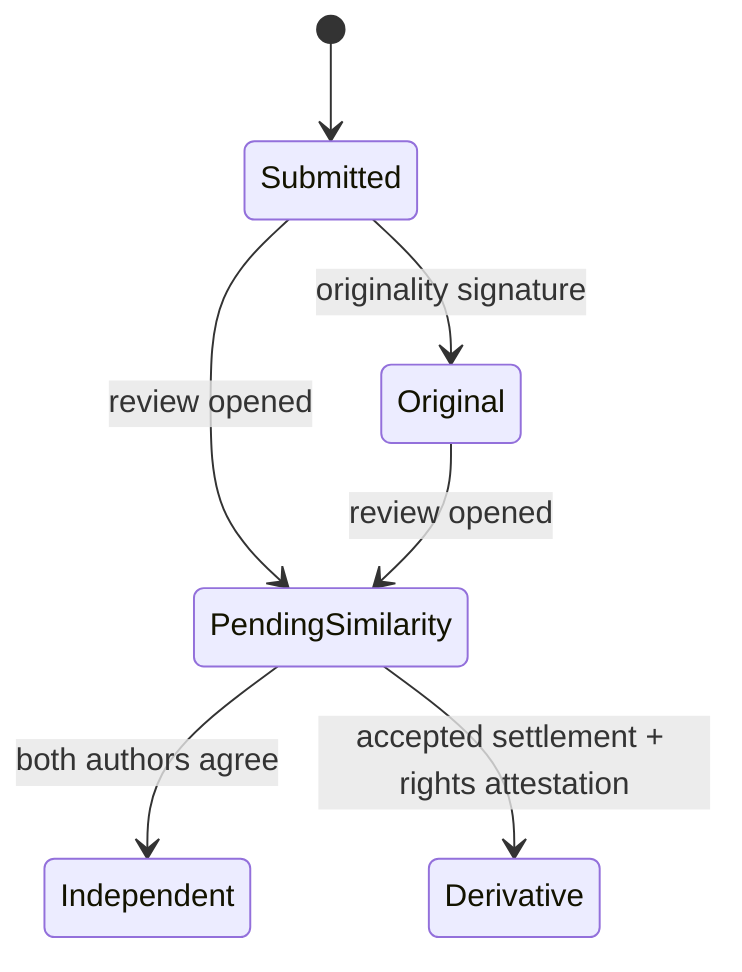
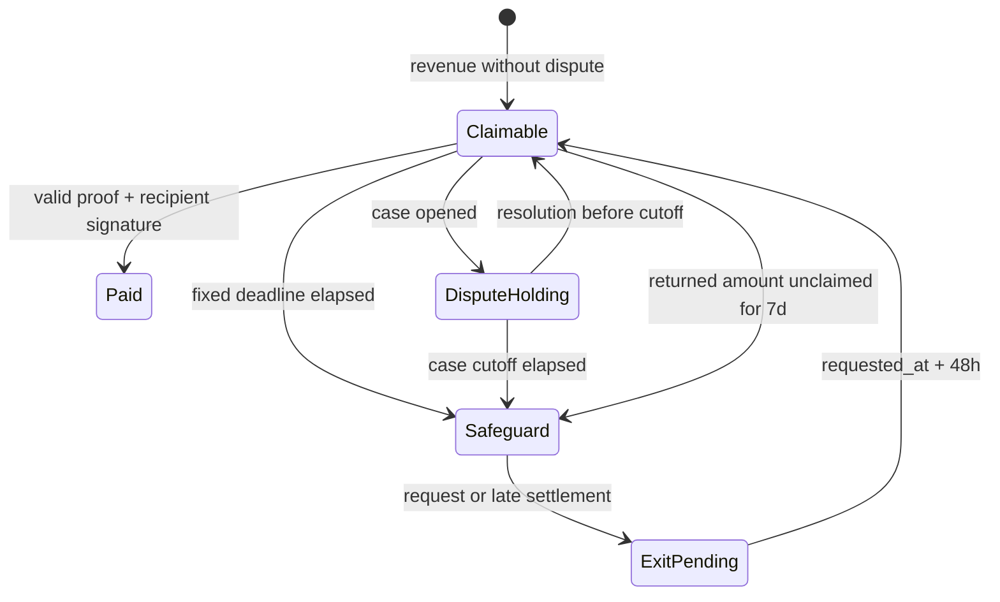
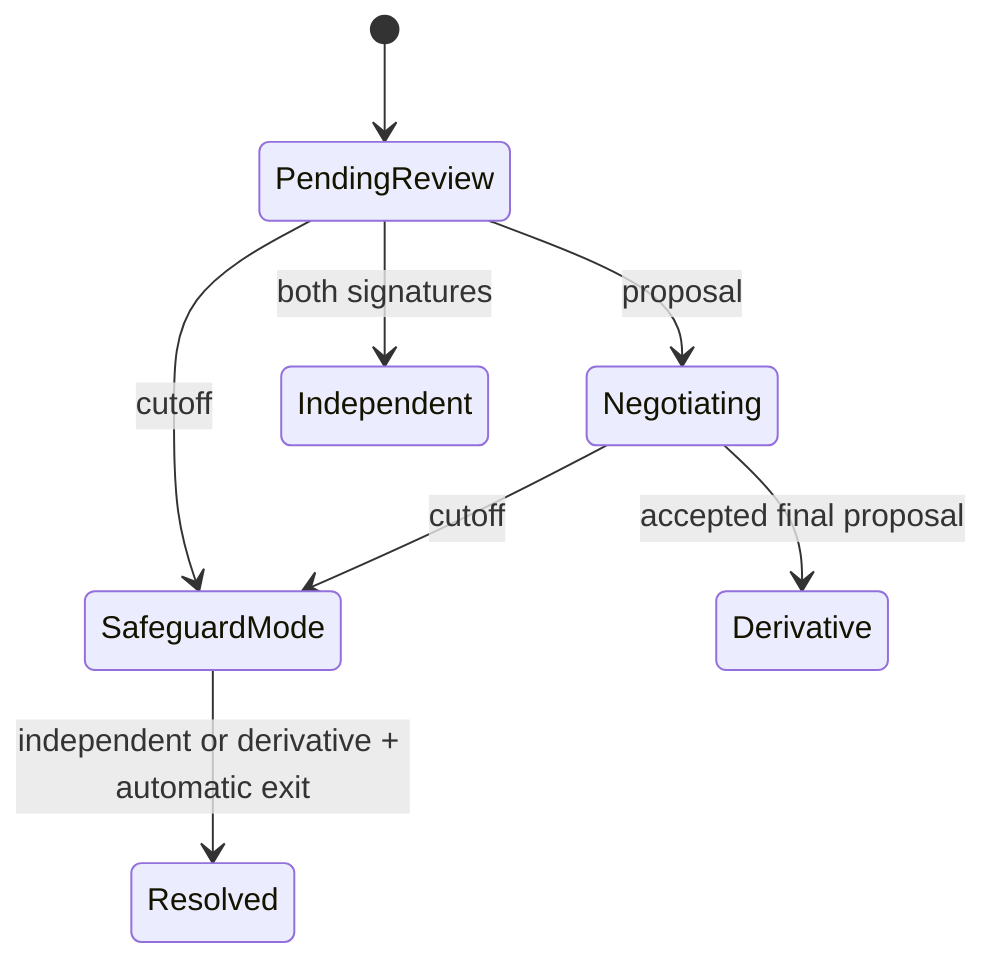

# State machines

Time transitions are checked inside financial instructions using Clock, and remain effective without an indexer or scheduled keeper. Partial claims and new deposits cannot move existing deadlines later.
